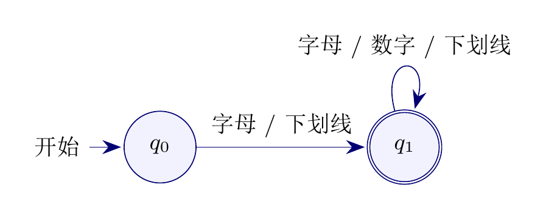
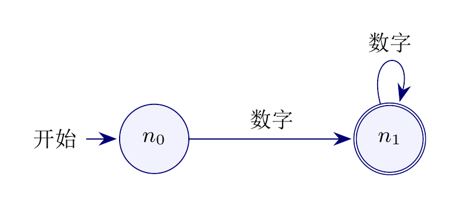

# 实验一：词法分析程序

> 导航：[仓库首页](../README.md) · 当前：实验一说明 · [C++ 实现](cpp/README.md) · [Python 实现](python/README.md)

## 实验题目

编写一个词法分析程序：输入源程序的字符流，输出词法单元（Token）序列。
词的类别与正则式由自己定义，并要求包含错误处理。

| 项目 | 要求 |
|---|---|
| 输入 | 字符流（源程序文本） |
| 输出 | 词法单元序列，每个单元形如 `(类别, "词素")` |
| 词类定义 | 自定义词法单元及其正则式 |
| 错误处理 | 报告非法字符及其位置（字符、行、列） |

本实验的语言子集是一个类 Pascal 的简易语言，包含 8 个关键字、标识符、整数、
赋值与关系运算符、四则运算符、括号和分号。

## 词法单元

| 类别 | Token 类型 | 词素 / 正则式 | 说明 |
|---|---|---|---|
| 关键字 | `IF` `THEN` `ELSE` `END` `REPEAT` `UNTIL` `READ` `WRITE` | `if` `then` `else` `end` `repeat` `until` `read` `write` | 共 8 个，全部小写，区分大小写 |
| 标识符 | `ID` | `[a-zA-Z_][a-zA-Z0-9_]*` | 变量名等 |
| 整数 | `NUM` | `[0-9]+` | 非负整数 |
| 赋值 | `ASSIGN` | `:=` | 赋值 |
| 关系 | `RELOP` | `=` `<>` `>` `<` `>=` `<=` | 六种关系运算符统一归类 |
| 算术 | `PLUS` `MINUS` `TIMES` `OVER` | `+` `-` `*` `/` | 加、减、乘、除 |
| 括号 | `LPAREN` `RPAREN` | `(` `)` | 圆括号 |
| 分隔 | `SEMI` | `;` | 语句结束 |
| 空白 | — | 空格、`\t`、`\n`、`\r` | 扫描时跳过，不输出 Token |

## 识别策略

- 每个词法类别对应一个 DFA，程序直接模拟其状态转移；
- 采用最长匹配：标识符/关键字 → 双字符运算符 → 整数 → 单字符运算符，按此优先级依次尝试；
- 关键字不单独占用正则式：先按标识符规则读出完整词素，再查关键字表，因此 `if` 是关键字而 `ifx` 是标识符；
- 双字符运算符（`:=` `<>` `>=` `<=`）向前看一个字符，避免被拆成两个单字符单元。

## 状态机（DFA）

词法分析器按四个识别器组织，扫描时按优先级依次尝试；空白字符直接跳过。
下面给出其中三个自动机；单字符运算符在运算符图中合并为一个终态，具体类别按字符查表得到。

### 标识符 / 关键字



`q0` 为初态，`q1` 为终态；`q1` 接受后查关键字表：命中则输出对应关键字，否则输出 `ID`。

### 整数



`n0` 为初态，`n1` 为终态；读到非数字字符时在 `n1` 接受并结束当前整数。

### 运算符

运算符比较简单，我们直接分为单字符运算符和双字符运算符来处理，直接用字符串处理即可，无需状态机。

## 错误处理

不属于任何合法词法单元的字符会触发词法错误，程序报告字符本身及其位置（以字符为单位）与行列号，例如：

```text
词法错误：非法字符 '@'，位置 8（第 1 行，第 9 列）
```

## 两份实现

| 语言 | 说明 | 详细文档 |
|---|---|---|
| C++17 | 按 DFA 手工实现四个识别器，输出格式与 Python 版逐字节一致 | [cpp/README.md](cpp/README.md) |
| Python | 原始参考实现，算法代码未作修改 | [python/README.md](python/README.md) |

## 目录

```text
Lab1/
├── README.md          本文件
├── assets/            状态机（DFA）图片
│   ├── dfa-identifier.png
│   ├── dfa-number.png
│   └── dfa-operator.png
├── cpp/               实验一的 C++17 实现
│   ├── include/       头文件（token、recognizer、error、utf8、text_util）
│   ├── src/           源文件与演示入口
│   ├── lab1.exe       已编译的可执行文件
│   └── README.md      C++ 实现详细说明
└── python/            实验一的 Python 参考实现
    ├── main.py        演示入口（7 组内置示例）
    ├── keywords.md    关键字与词法单元清单
    ├── utils/         扫描与识别模块
    └── README.md      Python 实现详细说明
```

## 运行结果（摘录）

```text
基本表达式：'example_id := 123 + 45;'
(ID, "example_id")
(ASSIGN, ":=")
(NUM, "123")
(PLUS, "+")
(NUM, "45")
(SEMI, ";")
```
